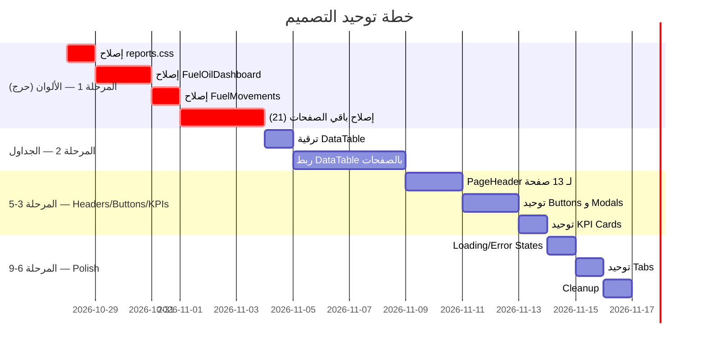

# 🔍 تقرير فحص شامل: تدقيق تصميم الواجهات الأمامية — FuelTrack

> **التاريخ:** 2026-10-27  
> **النطاق:** 42 صفحة + 5 مكونات UI مشتركة + ملفات CSS  
> **الهدف:** تحديد نقاط القوة والضعف في كل صفحة وتقديم خطة لتوحيد التصميم

---

## 📊 ملخص تنفيذي

| المعيار | الحالة | التقييم |
|---------|--------|---------|
| نظام التصميم (Design Tokens) | ✅ موجود وشامل | 8/10 |
| استخدام مكونات UI الموحدة | ⚠️ جزئي | 4/10 |
| توحيد ألوان (Design Token Compliance) | ❌ ضعيف جداً | 3/10 |
| توحيد الجداول | ❌ كل صفحة مختلفة | 2/10 |
| توحيد النماذج (Forms) | ⚠️ متوسط | 5/10 |
| توحيد المودال | ⚠️ جزئي | 5/10 |
| الترجمة (i18n) | ❌ معظم الصفحات يدوية | 2/10 |
| التبويب (Tabs) | ⚠️ أنماط متعددة | 4/10 |
| حالات التحميل/الخطأ/الفراغ | ⚠️ غير موحدة | 4/10 |
| بطاقات KPI | ⚠️ أنماط مختلفة | 4/10 |

**الخلاصة:** النظام يملك بنية تحتية تصميمية ممتازة (`styles.css` + مكونات `ui/`) لكن **أكثر من 70% من الصفحات لا تستخدمها بشكل كامل**. هناك تفاوت كبير بين الصفحات المُحدّثة (مثل Controllers, Users) والصفحات القديمة (مثل FuelOilDashboard, RollbackApproval, ReviewChanges).

---

## 🟢 نقاط القوة العامة

1. **نظام تصميم شامل** — [styles.css](file:///c:/Users/User/Desktop/FuelTrack-Rebuild/frontend/src/styles.css) يحتوي على 1684 سطر من المتغيرات والأنماط المنظمة
2. **دعم Dark/Light mode** — متغيرات CSS منفصلة لكل ثيم
3. **دعم RTL/LTR** — `direction`, `inset-inline-*`, `font-family` متبدلة
4. **مكتبة مكونات UI موحدة** — [Button](file:///c:/Users/User/Desktop/FuelTrack-Rebuild/frontend/src/components/ui/Button.jsx), [Modal](file:///c:/Users/User/Desktop/FuelTrack-Rebuild/frontend/src/components/ui/Modal.jsx), [DataTable](file:///c:/Users/User/Desktop/FuelTrack-Rebuild/frontend/src/components/ui/DataTable.jsx), [PageHeader](file:///c:/Users/User/Desktop/FuelTrack-Rebuild/frontend/src/components/ui/PageHeader.jsx), [FormField](file:///c:/Users/User/Desktop/FuelTrack-Rebuild/frontend/src/components/ui/FormField.jsx)
5. **Typography scale** — `--text-xs` إلى `--text-3xl` موحدة
6. **Spacing & border tokens** — `--radius-sm`, `--shadow-*`, `--border-*`
7. **أنماط Badge/Status موحدة** — `.badge-success`, `.badge-warning`, `.badge-danger`

---

## 🔴 نقاط الضعف العامة (الحرجة)

### 1. 🎨 ألوان مُشفرة (Hardcoded Colors) — **216+ حالة**

> [!CAUTION]
> هذه هي المشكلة الأكبر. الألوان المشفرة تكسر الثيم وتجعل التبديل بين Dark/Light mode غير سليم.

| الصفحة | عدد الألوان المشفرة | أمثلة |
|--------|---------------------|-------|
| [FuelOilDashboard.jsx](file:///c:/Users/User/Desktop/FuelTrack-Rebuild/frontend/src/pages/FuelOilDashboard.jsx) | **45+** | `#3b82f6`, `#10b981`, `#ef4444`, `#6b7280`, `#111827`, `#fef2f2`, `#fecaca` |
| [FuelMovements.jsx](file:///c:/Users/User/Desktop/FuelTrack-Rebuild/frontend/src/pages/FuelMovements.jsx) | **12+** | `#84cc16`, `#ef4444`, `#10b981`, `#fff` |
| [GeneratorsOverview.jsx](file:///c:/Users/User/Desktop/FuelTrack-Rebuild/frontend/src/pages/GeneratorsOverview.jsx) | **8+** | `#10b981`, `#fff` |
| [Notifications.jsx](file:///c:/Users/User/Desktop/FuelTrack-Rebuild/frontend/src/pages/Notifications.jsx) | **6+** | `hsla(4,84%,60%,...)`, `hsla(38,92%,...)`  |
| [RollbackApproval.jsx](file:///c:/Users/User/Desktop/FuelTrack-Rebuild/frontend/src/pages/RollbackApproval.jsx) | **10+** | `rgba(...)` hardcoded |
| [ReviewChanges.jsx](file:///c:/Users/User/Desktop/FuelTrack-Rebuild/frontend/src/pages/ReviewChanges.jsx) | **8+** | `rgba(...)` hardcoded |
| [Reports/reports.css](file:///c:/Users/User/Desktop/FuelTrack-Rebuild/frontend/src/pages/Reports/reports.css) | **15+** | `#3b82f6`, `#9ca3af`, `#d1d5db`, `#0f172a`, `#10b981`, `#ef4444`, `#f59e0b` |
| [MaintenanceDashboard.jsx](file:///c:/Users/User/Desktop/FuelTrack-Rebuild/frontend/src/pages/MaintenanceDashboard.jsx) | **5+** | `rgba(...)` |
| [OilStockPage.jsx](file:///c:/Users/User/Desktop/FuelTrack-Rebuild/frontend/src/pages/OilStockPage.jsx) | **5+** | `rgba(...)` |
| [FuelStockPage.jsx](file:///c:/Users/User/Desktop/FuelTrack-Rebuild/frontend/src/pages/FuelStockPage.jsx) | **5+** | `rgba(...)` |

### 2. 📋 عدم استخدام مكون DataTable الموحد — **0 صفحة تستخدمه**

> [!WARNING]
> مكون [DataTable.jsx](file:///c:/Users/User/Desktop/FuelTrack-Rebuild/frontend/src/components/ui/DataTable.jsx) موجود (264 سطر) لكن **لا تستخدمه أي صفحة على الإطلاق**. كل صفحة تبني جدولها الخاص بأسلوب مختلف.

| أسلوب الجدول | الصفحات |
|--------------|---------|
| `<table>` مع inline styles | FuelMovements, Generators, Users, WorkPermits, Controllers, TanksManagement, MetersManagement, LocationsManagement |
| `.data-table` CSS class | AuditLogs, SubStationReading |
| `.report-table` CSS class | Reports/* (6 صفحات) |
| `<table>` مع KPI cards مدمجة | StockInventory, PeriodicInventory |
| لا يوجد جدول (cards فقط) | Notifications, Dashboard, MaintenanceDashboard |

### 3. 🔘 أزرار غير موحدة

| النمط | الصفحات |
|-------|---------|
| ✅ `<Button>` من مكتبة UI | Controllers, Generators, Users, WorkPermits, TanksManagement, MetersManagement |
| ❌ `<button className="btn ...">` يدوي | FuelOilDashboard, RollbackApproval, ReviewChanges, Reports/index |
| ❌ `<button>` بدون class | بعض modals الداخلية في PeriodicInventory, RollbackApproval |

### 4. 🪟 Modals غير موحدة

| النمط | الصفحات |
|-------|---------|
| ✅ `<Modal>` من مكتبة UI | Controllers, Generators, Users, WorkPermits, TanksManagement, MetersManagement, LocationsManagement, WarehouseParts, WarehouseDispatch, SetupOils |
| ❌ Custom inline modal | ReviewChanges (RejectModal — `position: fixed; inset: 0`), PeriodicInventory (modal-overlay مباشر), FuelOilDashboard |
| ❌ لا يوجد modal | RollbackApproval (uses ConfirmModal فقط), MaintenanceDashboard |

### 5. 📑 عناوين الصفحات

| النمط | عدد الصفحات |
|-------|-------------|
| ✅ `<PageHeader>` موحد | 22 صفحة |
| ❌ `<h1>` يدوي أو `page-header` class مباشرة | FuelOilDashboard, MaintenanceDashboard, MovementLogs, MyGenerators, ActiveGenerators, Notifications, WarehouseStock, FuelStockPage, OilStockPage |
| ❌ header خاص بالتقارير | Reports/index (`.report-header`) |
| ❌ لا يوجد header | ReviewChanges, RollbackApproval |

---

## 📄 تحليل تفصيلي لكل صفحة

### صفحات بتقييم ممتاز (8-10/10)

| الصفحة | التقييم | ملاحظات |
|--------|---------|---------|
| [Controllers.jsx](file:///c:/Users/User/Desktop/FuelTrack-Rebuild/frontend/src/pages/Controllers.jsx) | 9/10 | PageHeader ✅, Button ✅, Modal ✅, FormField ✅, Design tokens ✅, Tabs `.ft-tab` ✅ |
| [Users.jsx](file:///c:/Users/User/Desktop/FuelTrack-Rebuild/frontend/src/pages/Users.jsx) | 8/10 | PageHeader ✅, Button ✅, Modal ✅, FormField ✅ — لكن بعض `rgba()` متبقية |
| [RolesManagement.jsx](file:///c:/Users/User/Desktop/FuelTrack-Rebuild/frontend/src/pages/RolesManagement.jsx) | 8/10 | PageHeader ✅, Button ✅, Modal ✅, i18n ✅ — بعض rgba |
| [AuditLogs.jsx](file:///c:/Users/User/Desktop/FuelTrack-Rebuild/frontend/src/pages/AuditLogs.jsx) | 8/10 | PageHeader ✅, Button ✅, Design tokens ✅ |

### صفحات بتقييم جيد (6-7/10)

| الصفحة | التقييم | نقاط القوة | نقاط الضعف |
|--------|---------|-----------|-----------|
| [Generators.jsx](file:///c:/Users/User/Desktop/FuelTrack-Rebuild/frontend/src/pages/Generators.jsx) | 7/10 | PageHeader, Button, Modal, FormField | جدول يدوي, `rgba()` متبقية, Pagination قديمة |
| [TanksManagement.jsx](file:///c:/Users/User/Desktop/FuelTrack-Rebuild/frontend/src/pages/TanksManagement.jsx) | 7/10 | PageHeader, Button, Modal, FormField | جدول يدوي |
| [MetersManagement.jsx](file:///c:/Users/User/Desktop/FuelTrack-Rebuild/frontend/src/pages/MetersManagement.jsx) | 7/10 | PageHeader, Button, Modal, FormField | جدول يدوي |
| [WorkPermits.jsx](file:///c:/Users/User/Desktop/FuelTrack-Rebuild/frontend/src/pages/WorkPermits.jsx) | 7/10 | PageHeader, Button, Modal, FormField | جدول يدوي, Pagination قديمة |
| [LocationsManagement.jsx](file:///c:/Users/User/Desktop/FuelTrack-Rebuild/frontend/src/pages/LocationsManagement.jsx) | 7/10 | PageHeader, Button, Modal, FormField | جدول شجري يدوي |
| [SetupOils.jsx](file:///c:/Users/User/Desktop/FuelTrack-Rebuild/frontend/src/pages/SetupOils.jsx) | 7/10 | PageHeader, Button, Modal, FormField | inline edit بدلاً من modal, جدول يدوي |
| [WarehouseParts.jsx](file:///c:/Users/User/Desktop/FuelTrack-Rebuild/frontend/src/pages/WarehouseParts.jsx) | 7/10 | PageHeader, Button, Modal, FormField | جدول يدوي, Pagination قديمة |
| [WarehouseDispatch.jsx](file:///c:/Users/User/Desktop/FuelTrack-Rebuild/frontend/src/pages/WarehouseDispatch.jsx) | 7/10 | PageHeader, Button, Modal, FormField | جدول يدوي, Pagination قديمة |
| [Dashboard.jsx](file:///c:/Users/User/Desktop/FuelTrack-Rebuild/frontend/src/pages/Dashboard.jsx) | 7/10 | PageHeader, Button, TanStack Query | HSL colors في chart (مقبول) |
| [FuelMovements.jsx](file:///c:/Users/User/Desktop/FuelTrack-Rebuild/frontend/src/pages/FuelMovements.jsx) | 6/10 | PageHeader, Button, Modal, i18n | **ألوان مشفرة كثيرة** (`#84cc16`, `#ef4444`), جدول يدوي ضخم (999 سطر) |
| [PeriodicInventoryPage.jsx](file:///c:/Users/User/Desktop/FuelTrack-Rebuild/frontend/src/pages/PeriodicInventoryPage.jsx) | 6/10 | PageHeader, Button | modal-overlay يدوي, جدول يدوي, 876 سطر ضخمة |

### صفحات بتقييم متوسط (4-5/10)

| الصفحة | التقييم | المشاكل الرئيسية |
|--------|---------|-----------------|
| [StockInventory.jsx](file:///c:/Users/User/Desktop/FuelTrack-Rebuild/frontend/src/pages/StockInventory.jsx) | 5/10 | لا PageHeader, جدول شجري يدوي, `rgba()` متبقية |
| [AddReading.jsx](file:///c:/Users/User/Desktop/FuelTrack-Rebuild/frontend/src/pages/AddReading.jsx) | 5/10 | PageHeader ✅ لكن `rgba()` كثيرة, نموذج كبير بدون FormField |
| [SubStationReading.jsx](file:///c:/Users/User/Desktop/FuelTrack-Rebuild/frontend/src/pages/SubStationReading.jsx) | 5/10 | PageHeader ✅ لكن `.data-table` class مباشرة, لا DataTable component |
| [OilInventory.jsx](file:///c:/Users/User/Desktop/FuelTrack-Rebuild/frontend/src/pages/OilInventory.jsx) | 5/10 | PageHeader ✅, Modal ✅ لكن `rgba()` وجدول يدوي |
| [InstalledParts.jsx](file:///c:/Users/User/Desktop/FuelTrack-Rebuild/frontend/src/pages/InstalledParts.jsx) | 5/10 | PageHeader ✅, Modal ✅ لكن `rgba()` وجدول يدوي |
| [WarehouseSupply.jsx](file:///c:/Users/User/Desktop/FuelTrack-Rebuild/frontend/src/pages/WarehouseSupply.jsx) | 5/10 | PageHeader ✅, Modal ✅ لكن جدول يدوي |
| [Notifications.jsx](file:///c:/Users/User/Desktop/FuelTrack-Rebuild/frontend/src/pages/Notifications.jsx) | 5/10 | لا PageHeader, `hsla()` مشفرة, تصميم بطاقات مخصص |
| [MovementLogs.jsx](file:///c:/Users/User/Desktop/FuelTrack-Rebuild/frontend/src/pages/MovementLogs.jsx) | 5/10 | لا PageHeader, جدول يدوي, لا Modal من UI |
| [ActiveGenerators.jsx](file:///c:/Users/User/Desktop/FuelTrack-Rebuild/frontend/src/pages/ActiveGenerators.jsx) | 5/10 | لا PageHeader, `#fff` hardcoded, Pagination قديمة |
| [MyGenerators.jsx](file:///c:/Users/User/Desktop/FuelTrack-Rebuild/frontend/src/pages/MyGenerators.jsx) | 5/10 | لا PageHeader, لا Modal من UI |

### صفحات بتقييم ضعيف (1-3/10)

| الصفحة | التقييم | المشاكل الرئيسية |
|--------|---------|-----------------|
| [FuelOilDashboard.jsx](file:///c:/Users/User/Desktop/FuelTrack-Rebuild/frontend/src/pages/FuelOilDashboard.jsx) | **2/10** | **45+ لون مشفر**, لا PageHeader, لا Button, لا Modal, spinner يدوي, لا design tokens, نمط مختلف تماماً عن باقي النظام |
| [ReviewChanges.jsx](file:///c:/Users/User/Desktop/FuelTrack-Rebuild/frontend/src/pages/ReviewChanges.jsx) | **2/10** | **ORPHAN** (غير مستخدم), لا PageHeader, modal يدوي, `rgba()` كثيرة, لا مكونات UI |
| [RollbackApproval.jsx](file:///c:/Users/User/Desktop/FuelTrack-Rebuild/frontend/src/pages/RollbackApproval.jsx) | **3/10** | لا PageHeader, لا Button, لا Modal, `rgba()` كثيرة, أزرار `<button>` يدوية |
| [MaintenanceDashboard.jsx](file:///c:/Users/User/Desktop/FuelTrack-Rebuild/frontend/src/pages/MaintenanceDashboard.jsx) | **3/10** | لا PageHeader من UI (يدوي), `rgba()` كثيرة, لا مكونات UI |
| [FuelStockPage.jsx](file:///c:/Users/User/Desktop/FuelTrack-Rebuild/frontend/src/pages/FuelStockPage.jsx) | **3/10** | لا PageHeader, `rgba()` كثيرة |
| [OilStockPage.jsx](file:///c:/Users/User/Desktop/FuelTrack-Rebuild/frontend/src/pages/OilStockPage.jsx) | **3/10** | لا PageHeader, `rgba()` كثيرة |
| [WarehouseStock.jsx](file:///c:/Users/User/Desktop/FuelTrack-Rebuild/frontend/src/pages/WarehouseStock.jsx) | **3/10** | لا PageHeader, `rgba()` كثيرة, Pagination قديمة |
| [WarehouseReports.jsx](file:///c:/Users/User/Desktop/FuelTrack-Rebuild/frontend/src/pages/WarehouseReports.jsx) | **3/10** | لا PageHeader, لا مكونات UI |
| [Reports/index.jsx](file:///c:/Users/User/Desktop/FuelTrack-Rebuild/frontend/src/pages/Reports/index.jsx) | **3/10** | CSS مستقل (`reports.css`) بـ **15+ لون مشفر**, أزرار بدون Button, أنماط خارج Design System |

---

## 🔄 جدول المقارنة: التنفيذ الحالي vs المطلوب

| المعيار | الحالي | المطلوب |
|---------|--------|---------|
| **الجداول** | `<table>` يدوي في كل صفحة | `<DataTable>` الموحد |
| **العناوين** | mix بين `<PageHeader>` و `<h1>` يدوي | `<PageHeader>` في كل مكان |
| **الأزرار** | mix بين `<Button>` و `<button className="btn">` | `<Button>` الموحد |
| **المودال** | mix بين `<Modal>` و inline modals | `<Modal>` الموحد |
| **النماذج** | mix بين `<FormField>` و `<label>`/`<input>` يدوي | `<FormField>` الموحد |
| **الألوان** | `#hex`, `rgba()`, `hsla()` مشفرة | `var(--token)` فقط |
| **التبويب** | `.ft-tab`, `.report-tab-btn`, أزرار مخصصة | `.ft-tab` الموحد |
| **الترقيم** | `<Pagination>` قديم + DataTable مدمج | `<DataTable>` مع ترقيم مدمج |
| **الحالات** | spinners مختلفة, empty states مختلفة | `<LoadingSpinner>`, `.empty-state` |
| **KPI Cards** | 4+ أنماط مختلفة | `.kpi-card` + `.kpi-grid` الموحد |
| **الترجمة** | يدوي (ternary) في 37 صفحة, i18n في 5 | i18n في الجميع (أو ternary موحد) |

---

## 📐 خريطة التوزيع: CSS files

| الملف | الحجم | الملاحظة |
|-------|-------|---------|
| [styles.css](file:///c:/Users/User/Desktop/FuelTrack-Rebuild/frontend/src/styles.css) | 68.8KB (1684 سطر) | ✅ نظام التصميم الرئيسي |
| [reports.css](file:///c:/Users/User/Desktop/FuelTrack-Rebuild/frontend/src/pages/Reports/reports.css) | 5.1KB (297 سطر) | ❌ **يعيد تعريف** KPI, tables, tabs بألوان مشفرة — يكسر التوحيد |
| [App.css](file:///c:/Users/User/Desktop/FuelTrack-Rebuild/frontend/src/App.css) | صغير | animations فقط |
| [index.css](file:///c:/Users/User/Desktop/FuelTrack-Rebuild/frontend/src/index.css) | صغير | reset فقط |

---

## 🛠️ خطة المعالجة الشاملة

### المرحلة 1: توحيد الألوان (Critical — الأولوية القصوى)

> **الهدف:** استبدال جميع الألوان المشفرة بـ CSS Variables

#### الخطوة 1.1: إصلاح reports.css
- استبدال `#3b82f6` → `var(--primary)`
- استبدال `#9ca3af` → `var(--text-muted)`
- استبدال `#d1d5db` → `var(--text-faint)`
- استبدال `#0f172a` → `var(--bg)`
- استبدال `#10b981` → `var(--success)`
- استبدال `#ef4444` → `var(--danger)`
- استبدال `#f59e0b` → `var(--warning)`
- استبدال `#111827` → `var(--text)`
- استبدال `#fef2f2`/`#fecaca` → `var(--danger-subtle)`
- استبدال `#fffbeb`/`#fde68a` → `var(--warning-subtle)`
- استبدال `rgba(255,255,255,0.05)` → `var(--surface-2)`

#### الخطوة 1.2: إصلاح FuelOilDashboard.jsx (الأسوأ — 45+ لون)
- تحويل كامل لاستخدام design tokens
- إضافة `PageHeader`, `Button`
- استبدال spinner يدوي بـ `.ft-spinner`

#### الخطوة 1.3: إصلاح FuelMovements.jsx
- `#84cc16` → إضافة `--lime: hsl(82,78%,44%)` و `--lime-subtle` للمخزون المتبقي
- `#ef4444` / `#10b981` → `var(--danger)` / `var(--success)`

#### الخطوة 1.4: إصلاح باقي الصفحات (Generators, Notifications, etc.)
- مسح كل `#hex` و `rgba()` في 21 صفحة واستبدالها

---

### المرحلة 2: توحيد الجداول (High Priority)

> **الهدف:** استخدام `<DataTable>` الموحد في جميع صفحات البيانات الجدولية

#### الخطوة 2.1: ترقية DataTable
- إضافة prop `stickyHeader` لرؤوس ثابتة
- إضافة prop `selectable` لتحديد صفوف
- إضافة prop `actions` لأزرار الإجراءات في كل صف
- إضافة prop `expandable` للصفوف القابلة للتوسيع
- إضافة prop `exportable` لدعم التصدير

#### الخطوة 2.2: ربط DataTable بالصفحات
قائمة الصفحات المطلوب تحويلها (بالترتيب):
1. `AuditLogs.jsx` — أبسط جدول (بداية جيدة)
2. `Users.jsx`
3. `Generators.jsx`
4. `WorkPermits.jsx`
5. `TanksManagement.jsx`
6. `MetersManagement.jsx`
7. `WarehouseParts.jsx`
8. `WarehouseDispatch.jsx`
9. `WarehouseSupply.jsx`
10. `InstalledParts.jsx`
11. `FuelMovements.jsx` (الأكثر تعقيداً — آخراً)
12. `MovementLogs.jsx`
13. `RollbackApproval.jsx`

#### الخطوة 2.3: توحيد جداول التقارير
- دمج `report-table` styles في DataTable عبر prop `variant="report"`
- أو استخدام DataTable مباشرة في Report components

---

### المرحلة 3: توحيد عناوين الصفحات (Medium Priority)

> **الهدف:** كل صفحة تستخدم `<PageHeader>`

الصفحات المطلوب إضافة PageHeader لها:
1. [FuelOilDashboard.jsx](file:///c:/Users/User/Desktop/FuelTrack-Rebuild/frontend/src/pages/FuelOilDashboard.jsx)
2. [MaintenanceDashboard.jsx](file:///c:/Users/User/Desktop/FuelTrack-Rebuild/frontend/src/pages/MaintenanceDashboard.jsx)
3. [MovementLogs.jsx](file:///c:/Users/User/Desktop/FuelTrack-Rebuild/frontend/src/pages/MovementLogs.jsx)
4. [Notifications.jsx](file:///c:/Users/User/Desktop/FuelTrack-Rebuild/frontend/src/pages/Notifications.jsx)
5. [MyGenerators.jsx](file:///c:/Users/User/Desktop/FuelTrack-Rebuild/frontend/src/pages/MyGenerators.jsx)
6. [ActiveGenerators.jsx](file:///c:/Users/User/Desktop/FuelTrack-Rebuild/frontend/src/pages/ActiveGenerators.jsx)
7. [StockInventory.jsx](file:///c:/Users/User/Desktop/FuelTrack-Rebuild/frontend/src/pages/StockInventory.jsx)
8. [FuelStockPage.jsx](file:///c:/Users/User/Desktop/FuelTrack-Rebuild/frontend/src/pages/FuelStockPage.jsx)
9. [OilStockPage.jsx](file:///c:/Users/User/Desktop/FuelTrack-Rebuild/frontend/src/pages/OilStockPage.jsx)
10. [WarehouseStock.jsx](file:///c:/Users/User/Desktop/FuelTrack-Rebuild/frontend/src/pages/WarehouseStock.jsx)
11. [WarehouseReports.jsx](file:///c:/Users/User/Desktop/FuelTrack-Rebuild/frontend/src/pages/WarehouseReports.jsx)
12. [RollbackApproval.jsx](file:///c:/Users/User/Desktop/FuelTrack-Rebuild/frontend/src/pages/RollbackApproval.jsx)
13. [Reports/index.jsx](file:///c:/Users/User/Desktop/FuelTrack-Rebuild/frontend/src/pages/Reports/index.jsx)

---

### المرحلة 4: توحيد الأزرار والمودال (Medium Priority)

#### الخطوة 4.1: استبدال أزرار يدوية بـ `<Button>`
الصفحات:
- FuelOilDashboard, RollbackApproval, ReviewChanges, Reports/index
- MaintenanceDashboard, StockInventory, Notifications
- MovementLogs, ActiveGenerators, MyGenerators

#### الخطوة 4.2: استبدال modals يدوية بـ `<Modal>`
- ReviewChanges.jsx: `RejectModal` → `<Modal>` + FormField
- PeriodicInventoryPage.jsx: `modal-overlay` → `<Modal>`
- RollbackApproval.jsx: ConfirmModal → `<Modal>` + Button

---

### المرحلة 5: توحيد بطاقات KPI (Medium Priority)

> **الهدف:** جميع KPI cards تستخدم `.kpi-card` + `.kpi-grid` الموحدة

الصفحات المطلوب تعديلها:
1. FuelOilDashboard — يستخدم style مخصص بالكامل
2. Reports/* — `.kpi-cards-row` مختلفة عن `.kpi-grid`
3. MaintenanceDashboard — كروت مخصصة
4. WarehouseReports — كروت مخصصة
5. StockInventory — KPI inline مخصصة

---

### المرحلة 6: توحيد حالات التحميل والخطأ (Low Priority)

> **الهدف:** حالة موحدة لـ loading, error, empty state

#### التحويل المطلوب:
- Loading: استخدام `<LoadingSpinner>` أو `.ft-spinner` + `.spinner-wrap`
- Error: استخدام `.error-state` + `.error-state-title`
- Empty: استخدام `.empty-state` + `.empty-state-icon` + `.empty-state-title`

#### الصفحات المتأثرة:
- FuelOilDashboard (spinner يدوي `border: 4px solid #e5e7eb`)
- عدة صفحات تستخدم `{loading && <div>...spinner...</div>}` يدوياً

---

### المرحلة 7: توحيد التبويب (Low Priority)

> **الهدف:** جميع tabs تستخدم `.ft-tab` أو مكون Tab موحد

| الصفحة | النمط الحالي | المطلوب |
|--------|-------------|---------|
| Controllers | `.ft-tab` ✅ | — |
| FuelMovements | `.ft-tab` ✅ | — |
| MetersManagement | `.ft-tab` ✅ | — |
| Reports/index | `.report-tab-btn` ❌ | `.ft-tab` |
| StockInventory | أزرار مخصصة ❌ | `.ft-tab` |
| RollbackApproval | أزرار مخصصة ❌ | `.ft-tab` |

---

### المرحلة 8: حذف الصفحات اليتيمة (Cleanup)

| الصفحة | الحالة | التوصية |
|--------|--------|---------|
| [ReviewChanges.jsx](file:///c:/Users/User/Desktop/FuelTrack-Rebuild/frontend/src/pages/ReviewChanges.jsx) | `ORPHAN: Not imported by any route` | **حذف** أو دمج مع RollbackApproval |

---

### المرحلة 9: إضافة Design Tokens مفقودة

```css
/* tokens مقترحة لإضافتها في :root */
--lime:           hsl(82, 78%, 44%);
--lime-subtle:    hsla(82, 78%, 44%, 0.12);
--orange:         hsl(24, 85%, 50%);
--orange-subtle:  hsla(24, 85%, 50%, 0.12);
```

---

## 📋 ملخص الأولويات



---

> [!IMPORTANT]
> **التوصية:** ابدأ بالمرحلة 1 (الألوان) لأنها الأكثر تأثيراً على تجربة المستخدم وتتعلق بدعم الـ Light/Dark theme. ثم انتقل للمرحلة 2 (الجداول) لتوحيد أكبر عنصر بصري في النظام.
