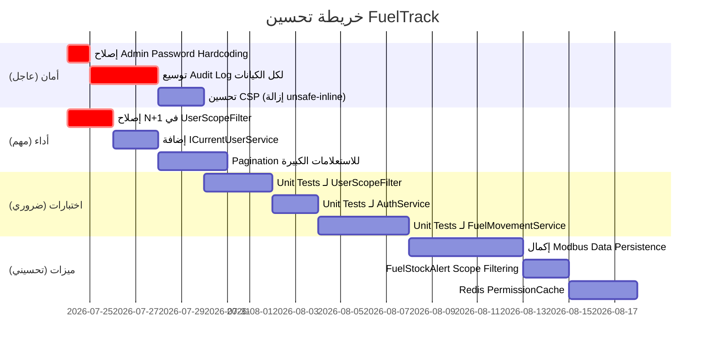

# 📊 تحليل نظام FuelTrack-Rebuild — تقرير شامل

> **تاريخ التحليل:** 2026-07-23  
> **إصدار النظام:** FuelTrack Rebuild v1 (Migration: `20260712152709_InitialSchema`)  
> **المحلل:** Antigravity AI — فحص شامل للكود المصدري  

---

## 🗂️ نظرة عامة على البنية المعمارية

```
FuelTrack-Rebuild/
├── src/
│   ├── FuelTrack.Domain           — نماذج المجال (36 كيان)
│   ├── FuelTrack.Application      — الواجهات + DTOs + Validators
│   ├── FuelTrack.Infrastructure   — الخدمات + EF Core + Migrations
│   ├── FuelTrack.API              — Controllers + Middleware + Jobs
│   └── FuelTrack.ModbusGateway    — بوابة أجهزة Modbus
├── frontend/                      — React + Vite (28 صفحة)
├── tests/                         — اختبارات الوحدة والتكامل
├── k8s/                           — إعدادات Kubernetes
└── docker-compose.yml             — بيئة Docker
```

**النمط المعماري:** Clean Architecture (Domain → Application → Infrastructure → API)  
**قاعدة البيانات:** SQL Server 2022  
**الواجهة الأمامية:** React + Vite  
**الاتصال الفوري:** SignalR  
**الجدولة الزمنية:** Hangfire  

---

## ✅ نقاط القوة

### 1. الأمان والحماية (🔒 ممتاز)

| العنصر | التفاصيل |
|--------|----------|
| **JWT + Refresh Token** | تخزين Hash للـ Token، Cookie-only بخيار `HttpOnly + Secure + SameSite=Strict` |
| **Token Reuse Detection** | عند إعادة استخدام Refresh Token، يتم إلغاء جميع التوكنات النشطة للمستخدم |
| **Rate Limiting متقدم** | 5 سياسات: `fixed`, `ApiRead`, `ApiWrite`, `Auth`, `login` — كل واحدة بمعدلات مختلفة |
| **Security Headers** | `X-Content-Type-Options`, `X-Frame-Options`, `CSP`, `HSTS`, `Permissions-Policy` |
| **Input Sanitization** | فلترة 30+ نمط XSS في الـ Middleware قبل وصول الطلب للـ Controller |
| **Account Lockout** | ASP.NET Identity Lockout على محاولات كلمة المرور الفاشلة |
| **Path Traversal** | كشف `..` و `%2e%2e` وحظرها تلقائياً |
| **Secrets Validator** | يتحقق من JWT Key / ConnectionString / Admin Password عند بدء التشغيل |
| **API Hardening** | حد 1MB للـ Request Body وحد 2048 حرفاً للـ QueryString |

### 2. نظام الصلاحيات والنطاق (🛡️ متكامل جداً)

- **نظام `UserScope`:** نطاق بياني هرمي (Branch → Station → SubStation) بجدول مسطح واحد بدلاً من جداول وصل متعددة
- **`UserScopeFilterAttribute`:** فلتر تفويض عالمي يُطبَّق على كل نقطة نهاية تلقائياً
- **`UserScopeFilterService`:** يُطبق قواعد "الكل" (`null = All`) بشكل متماسك عبر 7 خدمات
- **`PermissionEnforcementMiddleware`:** نظام صلاحيات على مستوى الوحدة+الإجراء (`module.action`) مع Cache ذكي
- **`PermissionCache`:** كاش في الذاكرة للصلاحيات لتفادي استعلامات DB في كل طلب
- **دعم الصلاحيات المميزة:** مسارات الاعتماد (`/approve`, `/reject`, `/execute`, `/review`) تحتاج صلاحية منفصلة

### 3. قابلية المراقبة والتتبع (📊 جيدة جداً)

- **Serilog:** تسجيل منهجي مع بنية منظمة
- **OpenTelemetry + Jaeger:** تتبع الطلبات end-to-end (اختياري بناءً على OTEL_ENDPOINT)
- **SlowQueryInterceptor:** اكتشاف الاستعلامات البطيئة (>1000ms) تلقائياً
- **CorrelationId Middleware:** ربط كل طلب بـ ID فريد للتتبع
- **RequestLogging Middleware:** توثيق كل طلب مع الوقت والمسار
- **Health Checks:** 3 نقاط (`/health`, `/health/live`, `/health/ready`) مع تفاصيل DB + Redis
- **Prometheus:** تصدير المقاييس اختياري عبر `/metrics`
- **Hangfire Dashboard:** واجهة لمراقبة الوظائف الخلفية

### 4. المهام الخلفية (⚙️ متكاملة)

| الوظيفة | الجدول |
|---------|--------|
| `CleanupExpiredRefreshTokensJob` | يومياً |
| `CleanupOldAuditLogsJob` | أسبوعياً |
| `DatabaseMaintenanceJob` | شهرياً |
| `DatabaseBackupJob` | كل يوم 2 صباحاً |
| `FuelStockAlertJob` | يومياً (تنبيهات البريد) |
| `GenerateDailyAnalyticsInsightsJob` | يومياً |
| `WeeklyReportJob` | كل اثنين 8 صباحاً |

### 5. بنية الكود (🏗️ نظيفة)

- **Clean Architecture** مطبقة بالكامل مع فصل واضح للمسؤوليات
- **`BaseEntity`** موحد: `Id`, `IsActive`, `CreatedAt/By`, `UpdatedAt/By`, `DeletedAt` (Soft Delete)
- **Soft Delete** مطبق على جميع الكيانات
- **FluentValidation** لاعتماد البيانات في طبقة Application
- **AutoMapper** لتحويل الكيانات إلى DTOs
- **API Versioning** مدعوم (v1, v2) عبر URL وHeader وQueryString
- **`HybridCacheService`:** كاش ثنائي (MemoryCache + Redis) مع Fallback
- **EF Core Retry:** إعادة محاولة تلقائية 5 مرات على فشل قاعدة البيانات

### 6. بوابة Modbus (📡 حضور أساسي)

- خدمة `BackgroundService` مستقلة تستطلع الأجهزة كل 5 ثوانٍ
- إرسال القراءات للـ SignalR Hub في الوقت الفعلي
- إعادة الاتصال التلقائي عند انقطاع الاتصال

---

## ⚠️ نقاط الضعف

### 1. نظام ترقيم الصفحات (Pagination) — غائب في بعض الأماكن

```csharp
// مثال: RollbackService.GetHistoryAsync() — لا يوجد Pagination
return await _db.AuditLogs
    .Where(x => x.IsActive)
    .OrderByDescending(x => x.Timestamp)
    .Join(_db.Users, ...)
    .ToListAsync(); // ⚠️ سيُعيد جميع السجلات بلا حدود
```

- **التأثير:** في بيئات الإنتاج مع آلاف سجلات التدقيق، سيُحدث ضغطاً على الذاكرة والشبكة
- **الخدمات المتأثرة:** `RollbackService`, `AuditService`, `AnalyticsInsightService`

### 2. Audit Logging — ضعف في التفاصيل

```csharp
// في AuditLoggingMiddleware — ReadExistingEntityAsync:
switch (entityName)
{
    case "Users":
        var user = await db.Users.FindAsync(entityId);
        return user is not null ? JsonSerializer.Serialize(user, JsonOptions) : null;
    case "Roles":
        var role = await db.Roles.FindAsync(entityId);
        return role is not null ? JsonSerializer.Serialize(role, JsonOptions) : null;
    default:
        return null; // ⚠️ معظم الكيانات لا يتم حفظ قيمها القديمة
}
```

- `EntityId` يُحفظ دائماً كـ `0` في معظم الحالات
- لا تُحفظ القيم القديمة إلا لـ `Users` و `Roles` فقط
- `FuelTransactions`, `OilTransactions` وغيرها لا تُتتبع before/after

### 3. Modbus Gateway — غير مكتمل

```csharp
// Mock reading interpretation
float value = InterpretFloat(registers);
// لا يوجد ربط بـ Generator/FuelTank حقيقي في قاعدة البيانات
```

- البوابة تقرأ البيانات وترسلها عبر SignalR لكنها **لا تحفظها في قاعدة البيانات**
- لا يوجد ربط بين `DeviceId` في Modbus و `Generator.Id` في النظام
- البيانات المباشرة من الأجهزة مؤقتة وتضيع عند إعادة التشغيل
- تفسير الـ Register ثابت (2 registers فقط) وغير قابل للتكوين

### 4. كاش `RemoveByPrefixAsync` — استخدام Reflection غير آمن

```csharp
var field = typeof(MemoryCache).GetField("_entries",
    System.Reflection.BindingFlags.NonPublic | System.Reflection.BindingFlags.Instance);
```

- هذا يعتمد على حقل خاص داخلي قد يتغير في إصدارات .NET المستقبلية
- لا يعمل على الـ Distributed Cache لإزالة المفاتيح بالـ Prefix
- قد يفشل بصمت دون إخطار

### 5. `FuelStockAlertJob` — إرسال للجميع بدون تصفية

```csharp
var recipients = await _db.Users
    .Where(u => u.IsActive && !string.IsNullOrEmpty(u.Email) && u.EmailConfirmed)
    .Select(u => new { u.Email, u.FullName })
    .ToListAsync(ct);
// ⚠️ يرسل البريد لجميع المستخدمين النشطين بغض النظر عن نطاق صلاحياتهم
```

- يجب أن يتلقى التنبيه فقط المستخدمون الذين لديهم وصول للمحطة الفرعية المتأثرة

### 6. `UserScopeFilterService` — N+1 Query Problem

```csharp
foreach (var scope in scopes)
{
    if (scope.StationId.HasValue)
    {
        var ids = await _db.SubStations // ⚠️ استعلام منفصل لكل Scope
            .Where(ss => ss.StationId == scope.StationId.Value ...)
            .Select(ss => ss.Id)
            .ToListAsync();
    }
}
```

- لمستخدم لديه 10 محطات في نطاقه، سيُنفَّذ 10 استعلامات منفصلة
- يجب دمجها في استعلام واحد باستخدام `WHERE StationId IN (...)`

### 7. تكرار المنطق في الخدمات

```csharp
// هذا النمط متكرر في 7+ خدمات
private int? GetCurrentUserId()
{
    var claim = _httpContextAccessor.HttpContext?.User.FindFirst(ClaimTypes.NameIdentifier);
    return claim != null && int.TryParse(claim.Value, out var id) ? id : null;
}

private bool IsAdmin()
{
    var user = _httpContextAccessor.HttpContext?.User;
    return user != null && (user.IsInRole("Admin") || user.IsInRole("SystemOwner"));
}
```

- يظهر في `FuelMovementService`, `ReportService`, `OilTransactionService`, `ReadingService`, `PeriodicInventoryService` وغيرها
- يجب استخلاصه في `BaseService` أو `ICurrentUserService`

### 8. تغطية الاختبارات — محدودة

```
tests/FuelTrack.Tests/
├── Integration/ (7 ملفات)     — تغطية جزئية للـ API
├── Services/ (خالية تقريباً)  — لا اختبارات وحدة للخدمات
└── ViewIntegrationTests.cs
```

- لا توجد اختبارات وحدة (`Unit Tests`) للخدمات الحيوية
- `FuelMovementService` (716 سطر) و`ReportService` (687 سطر) بدون اختبارات
- `UserScopeFilterService` بدون اختبارات رغم حيويته الأمنية

### 9. إدارة الـ Admin الافتراضي

```csharp
// Program.cs:405 — كلمة مرور Admin ثابتة في الكود
var createResult = await userManager.CreateAsync(adminUser, "Admin@123");
```

- كلمة المرور الافتراضية ثابتة في الكود مباشرة
- يجب قراءتها من الـ Configuration فقط (`AdminSettings:DefaultPassword`)

### 10. CSP (Content Security Policy) — قيود غير كافية

```csharp
headers["Content-Security-Policy"] =
    "default-src 'self'; connect-src 'self' wss: ws:; img-src 'self' data:; style-src 'self' 'unsafe-inline'";
```

- `'unsafe-inline'` في `style-src` يفتح ثغرة CSS Injection
- يجب استخدام `nonce` بدلاً من `unsafe-inline`

---

## 🚀 نقاط التحسين المقترحة

### الأولوية العالية 🔴

#### 1. إصلاح N+1 في `UserScopeFilterService`

```csharp
// بدلاً من:
foreach (var scope in scopes)
{
    var ids = await _db.SubStations.Where(...).ToListAsync();
}

// الحل المقترح:
var stationIds = scopes.Where(s => s.StationId.HasValue).Select(s => s.StationId.Value).ToList();
var branchIds = scopes.Where(s => s.BranchId.HasValue && !s.StationId.HasValue).Select(s => s.BranchId.Value).ToList();

var subStationIds = await _db.SubStations
    .Where(ss =>
        (stationIds.Contains(ss.StationId)) ||
        (branchIds.Contains(ss.Station.BranchId)))
    .Select(ss => ss.Id)
    .ToListAsync();
```

#### 2. إضافة `ICurrentUserService` مشترك

```csharp
// Application/Interfaces/ICurrentUserService.cs
public interface ICurrentUserService
{
    int? UserId { get; }
    bool IsAdmin { get; }
    bool IsSystemOwner { get; }
    IEnumerable<string> Roles { get; }
}

// تسجيل كـ Scoped في DependencyInjection.cs
services.AddScoped<ICurrentUserService, CurrentUserService>();
```

#### 3. إصلاح `AuditLoggingMiddleware` — حفظ EntityId الحقيقي

```csharp
// حالياً:
EntityId = 0, // ⚠️ دائماً صفر

// المطلوب:
EntityId = ExtractEntityIdFromPath(path) ?? 0,
```

وتوسيع `ReadExistingEntityAsync` لتشمل جميع الكيانات المتتبعة.

---

### الأولوية المتوسطة 🟡

#### 4. Pagination إلزامي للاستعلامات الكبيرة

```csharp
// إضافة صفحات لـ:
// - RollbackService.GetHistoryAsync()
// - AuditService.GetLogsAsync()
// - AnalyticsInsightService.GetInsightsAsync()

public record PaginationParams(int Page = 1, int PageSize = 50);

public async Task<PagedResult<RollbackListDto>> GetHistoryAsync(PaginationParams pagination)
{
    var query = _db.AuditLogs.Where(x => x.IsActive).OrderByDescending(x => x.Timestamp);
    var total = await query.CountAsync();
    var items = await query.Skip((pagination.Page - 1) * pagination.PageSize)
                           .Take(pagination.PageSize)
                           .Join(_db.Users, ...)
                           .ToListAsync();
    return new PagedResult<RollbackListDto>(items, total, pagination.Page, pagination.PageSize);
}
```

#### 5. إكمال بوابة Modbus

```csharp
// ModbusPollingService — خطوات التحسين:
// 1. إضافة GeneratorId في تكوين الجهاز
// 2. حفظ القراءة في DailyReadings عبر IReadingService
// 3. دعم Holding/Input/Coil Registers المختلفة
// 4. إضافة Circuit Breaker لمنع الاستطلاع المستمر عند فشل الاتصال
```

#### 6. `FuelStockAlertJob` — تصفية المستلمين حسب النطاق

```csharp
// بدلاً من إرسال لجميع المستخدمين:
// 1. تحديد المستخدمين الذين لديهم وصول للـ SubStation المنخفضة
// 2. إرسال فقط لمن لهم Scope مناسب

var scopedRecipients = await _scopeFilter.GetUsersWithAccessAsync(tank.SubStationId);
```

#### 7. استبدال Reflection في `RemoveByPrefixAsync`

```csharp
// الحل الأبسط: استخدام MemoryCacheWrapper مع تتبع المفاتيح
public class TrackedMemoryCache : IMemoryCache
{
    private readonly ConcurrentDictionary<string, bool> _keys = new();
    // تتبع المفاتيح عند الإضافة والحذف
}
```

---

### الأولوية المنخفضة 🟢

#### 8. اختبارات الوحدة للخدمات الحيوية

```
الخدمات ذات الأولوية للاختبار:
1. UserScopeFilterService (أمني — حيوي)
2. AuthService (JWT / Refresh Token)
3. FuelMovementService (منطق عمل معقد)
4. ReportService (حسابات المخزون)
5. PermissionEnforcementMiddleware
```

#### 9. تحسين CSP

```csharp
// استبدال:
"style-src 'self' 'unsafe-inline'"

// بـ:
var nonce = GenerateNonce();
context.Items["csp-nonce"] = nonce;
$"style-src 'self' 'nonce-{nonce}'"
```

#### 10. إضافة Redis لـ PermissionCache

```csharp
// PermissionCache حالياً InMemory فقط — عند نشر عدة Replicas
// يؤدي لعدم تزامن الصلاحيات بين الـ Instances
// الحل: نقل PermissionCache إلى ICacheService (Redis-backed)
```

#### 11. توثيق API بالـ XML Comments

```csharp
// معظم Controllers تفتقر للـ XML Documentation
/// <summary>
/// Creates a new fuel movement transaction.
/// </summary>
/// <param name="dto">Transaction details</param>
/// <returns>Created transaction with full details</returns>
[HttpPost]
public async Task<IActionResult> Create([FromBody] CreateFuelMovementDto dto)
```

#### 12. إضافة CQRS Pattern للعمليات المعقدة

- `ReportService` (687 سطر) و`FuelMovementService` (716 سطر) يمكن تقسيمها إلى Query/Command Handlers
- يُحسّن إمكانية الاختبار والقراءة
- يُسهّل إضافة ميزات مستقبلية

#### 13. إضافة Background Processing للـ Audit Logs

```csharp
// حالياً: حفظ Audit Log بشكل متزامن (يمكن أن يُبطئ الاستجابة)
// المقترح: استخدام Channel<AuditLog> أو Hangfire لحفظها بشكل غير متزامن
_ = SaveAuditLogAsync(...); // ⚠️ fire-and-forget بدون إدارة أخطاء كافية
```

#### 14. إضافة تدقيق المواعيد الزمنية (Timezone)

```csharp
// جميع التواريخ مخزنة UTC لكن لا يوجد تحويل للتوقيت المحلي في التقارير
// يجب إضافة TimeZone support في DTOs أو ReportService
```

---

## 📈 ملخص النقاط القابلة للقياس

| المجال | النتيجة الحالية | الهدف المقترح |
|--------|----------------|---------------|
| تغطية الاختبارات | ~15% (Integration فقط) | 70%+ (Unit + Integration) |
| N+1 Queries | موجودة في UserScopeFilterService | 0 N+1 Queries |
| Audit Log Coverage | Users + Roles فقط | جميع الكيانات الـ 14 |
| Modbus Data Persistence | 0% (In-memory فقط) | 100% (مخزون في DB) |
| Email Alert Filtering | 0% (لجميع المستخدمين) | 100% (بحسب النطاق) |
| API Documentation | جزئية (Swagger بدون XML) | مكتملة مع XML Docs |

---

## 🎯 خريطة الطريق المقترحة



---

## 🏆 الخلاصة التقييمية

| المعيار | التقييم | الملاحظات |
|---------|---------|-----------|
| **الأمان** | ⭐⭐⭐⭐⭐ | منظومة متكاملة وشاملة |
| **البنية المعمارية** | ⭐⭐⭐⭐½ | Clean Architecture مطبقة بجودة عالية |
| **نظام الصلاحيات** | ⭐⭐⭐⭐⭐ | UserScope متطور ومرن |
| **الأداء** | ⭐⭐⭐½ | N+1 queries تحتاج معالجة |
| **قابلية الصيانة** | ⭐⭐⭐⭐ | كود نظيف لكن تكرار في بعض الأماكن |
| **تغطية الاختبارات** | ⭐⭐ | تحتاج تحسيناً جذرياً |
| **التوثيق** | ⭐⭐⭐ | Swagger موجود لكن XML Comments ناقصة |
| **Observability** | ⭐⭐⭐⭐⭐ | OpenTelemetry + Serilog + HealthChecks |
| **IoT Integration** | ⭐⭐ | Modbus Gateway بحاجة لإكمال |
| **التشغيل** | ⭐⭐⭐⭐ | Docker + K8s + Hangfire جاهزة |

**المتوسط العام: 3.75 / 5** — نظام ناضج مع نقاط محددة للتحسين

